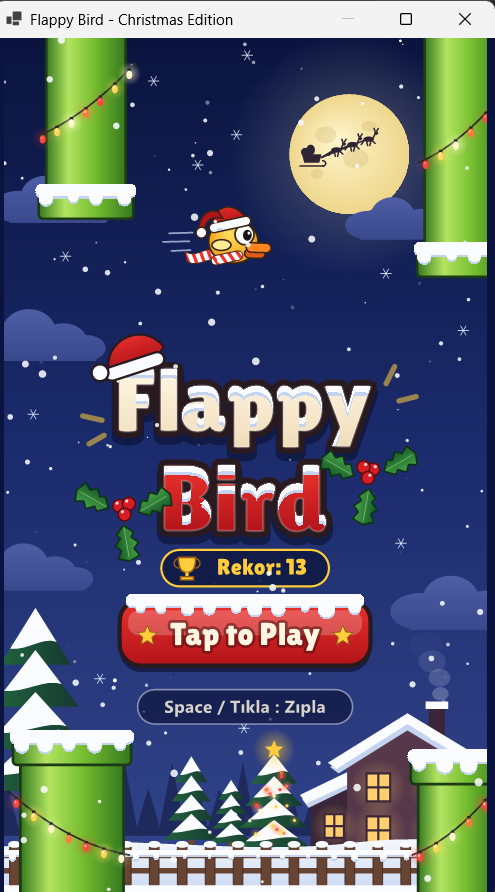
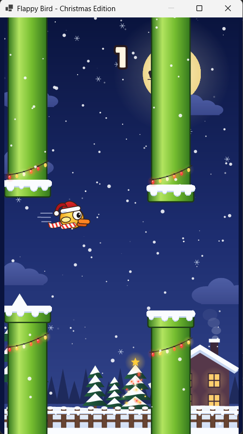
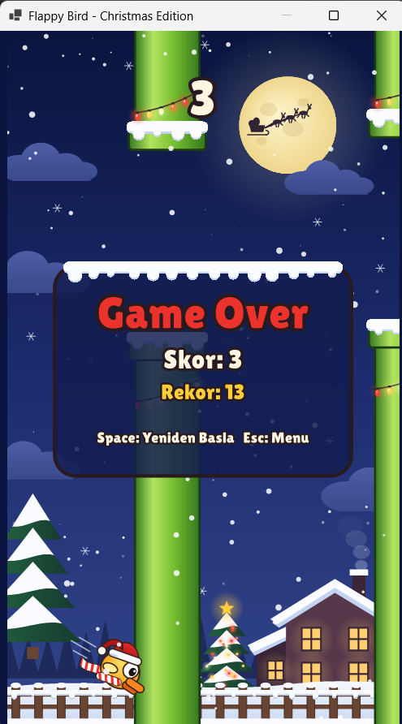

# YMH219-FlappyBird — Christmas Edition

Nesne Tabanlı Programlama (YMH 219) dersi için C# ve Windows Forms ile geliştirilmiş, yılbaşı temalı Flappy Bird benzeri masaüstü oyunu.

Oyuncu, Noel Baba şapkalı kuşu klavye veya fareyle zıplatarak sağdan sola kayan karlı boruların arasından geçirmeye çalışır. Her geçilen boru skoru artırır, skor arttıkça oyun hızlanır. Kuş bir boruya ya da zemine çarptığında oyun biter.

## Ekran Görüntüleri

| Giriş ekranı | Oyun | Oyun sonu |
|:---:|:---:|:---:|
|  |  |  |

## Kullanılan Teknolojiler

- C# / .NET 10 (`net10.0-windows`)
- Windows Forms
- GDI+ (`System.Drawing`): kuş, borular, arka plan ve arayüzdeki tüm görseller resim dosyası kullanılmadan kodla çizilir
- Harici NuGet paketi kullanılmamıştır
- Başlık yazı tipi: [Lilita One](https://fonts.google.com/specimen/Lilita+One) (SIL Open Font License, `FlappyBird/Assets/Fonts/OFL.txt`)

## Kurulum ve Çalıştırma

1. Depoyu klonlayın:
   ```
   git clone https://github.com/cenaismail/YMH219-flappyBird.git
   ```
2. `FlappyBird/FlappyBird.slnx` dosyasını Visual Studio ile açın (.NET 10 SDK gereklidir).
3. **F5** tuşuna basarak derleyip çalıştırın.

## Kontroller

| Tuş | İşlev |
|---|---|
| Space / ↑ / Enter veya fare tıklaması | Oyunu başlat, zıpla |
| Space (oyun bitince) | Yeniden başlat |
| Esc | Menüye dön |

## Temel Özellikler

- Kuş tuşa basınca zıplar, yer çekimi etkisiyle aşağı düşer
- Üç boru çifti sağdan sola kayar; ekrandan çıkan boru rastgele yükseklikte yeniden konumlandırılır
- Boruya veya zemine çarpınca oyun durur ve Game Over paneli gösterilir
- Geçilen her boru skoru 1 artırır
- Skor arttıkça boruların hızı artar (seviye ilerledikçe zorlaşma)
- En yüksek skor `highscore.txt` dosyasında saklanır, menüde ve oyun sonunda gösterilir
- Yılbaşı teması: yağan kar, yanıp sönen ışıklar, ay önünden geçen kızak, baca dumanı
- Pencere yeniden boyutlandırılabilir; oyun 450×800'lük sanal ekrana göre çizilip pencereye ölçeklenir

## Proje Yapısı ve Sınıflar

```
FlappyBird/
├── Program.cs              Uygulamanın giriş noktası
├── Form1.cs                Pencere, Timer ile oyun döngüsü, KeyDown/KeyUp ve fare olayları
├── Core/
│   ├── Game.cs             Oyun durumu, skor, hız, çarpışma kontrolü ve tüm nesnelerin yönetimi
│   ├── GameState.cs        Menu / Playing / GameOver durumları (enum)
│   └── HighScore.cs        En yüksek skoru dosyadan okuma/dosyaya yazma (hata kontrollü)
├── Entities/
│   ├── Bird.cs             Kuş: konum, hız, yer çekimi, zıplama, çizim
│   ├── Pipe.cs             Tek boru: çarpışma alanları ve çizim
│   └── PipePair.cs         Üst + alt boru ikilisi: kayma, yeniden konumlanma, geçilme kontrolü
├── Scene/
│   ├── Background.cs       Gökyüzü, ay, bulutlar, ev, ağaçlar, çit ve zemin
│   ├── LightString.cs      Yanıp sönen yılbaşı ışıkları
│   └── Snowfall.cs         Yağan kar
├── UI/
│   └── StartScreen.cs      Başlık, "Tap to Play" butonu, rekor rozeti ve kontrol ipucu
└── Rendering/
    ├── Palette.cs          Renkler
    ├── Shapes.cs           Ortak çizim yardımcıları
    └── FontManager.cs      Yazı tiplerini yükleme
```

**Tasarım notları**

- `Form1` yalnızca olayları yakalar ve `Game` sınıfına iletir; oyun mantığı ve çizim formdan ayrıdır.
- `Game` sınıfı, `GameState` değerine göre (`switch`) her karede farklı davranır.
- Oyun ayarları (`GapSize`, `PipeSpacing`, `StartSpeed`, `Gravity`, `JumpVelocity` vb.) ilgili sınıfların başında sabit olarak tanımlıdır.
- Dosya işlemleri `try-catch` ile korunur; rekor dosyası yoksa, bozuksa veya okunamıyorsa oyun rekoru 0 kabul ederek çalışmaya devam eder.

## Bilinen Sınırlamalar / Geliştirme Notları

- Ses efekti yoktur.
- Zorluk seviyesi seçimi yoktur; zorluk yalnızca skor arttıkça artan hızla belirlenir.
- `highscore.txt` programın `.exe` dosyasının bulunduğu klasöre yazılır; proje temizlenip yeniden derlenirse rekor sıfırlanabilir.
- Başlık yazı tipinde `ş`, `ğ`, `İ` harfleri bulunmadığı için oyun içi bazı yazılarda bu harfler kullanılmamıştır.

## Öğrenci

- **Ad Soyad:** _Cena İsmail_
- **Öğrenci No:** _250541615_
